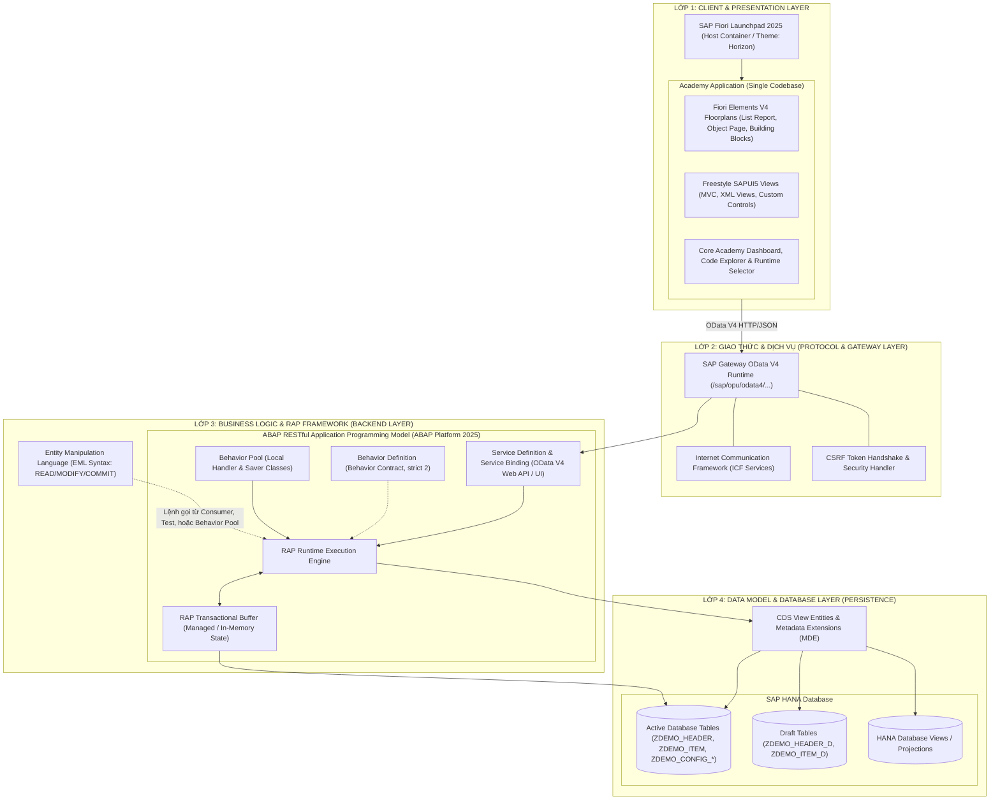
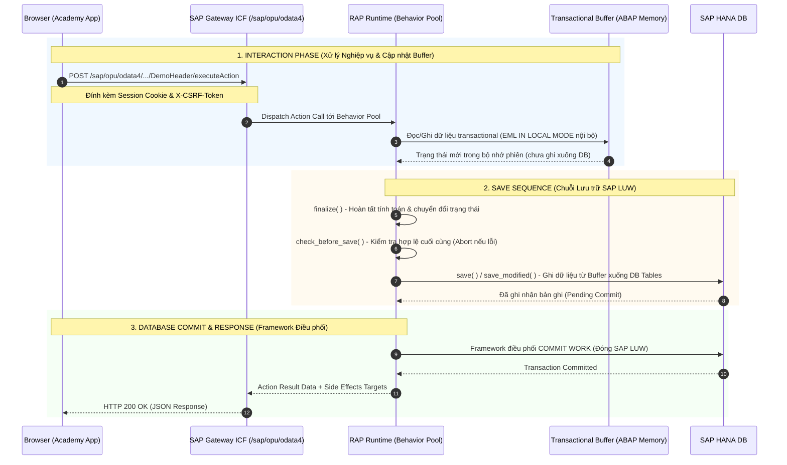
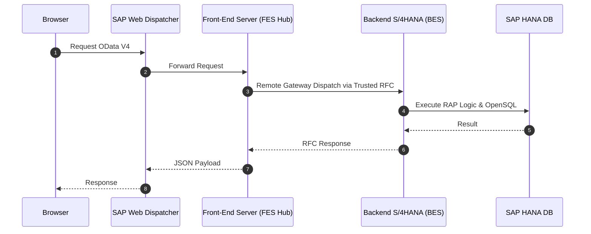
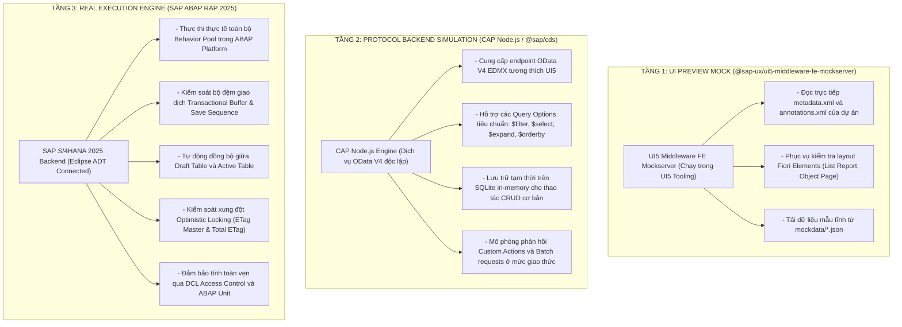
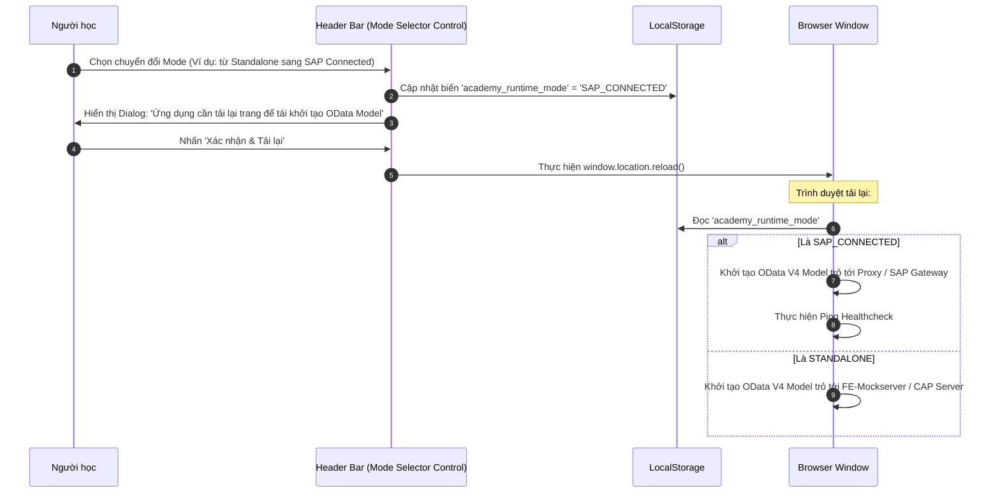

# TÀI LIỆU KIẾN TRÚC HỆ THỐNG: SAP FIORI TECHNICAL ACADEMY – V4

---

## 1. Kiến trúc Đa tầng Tổng thể (Multi-Tier Architecture)

Hệ thống được thiết kế theo mô hình phân tầng doanh nghiệp hiện đại của SAP, đảm bảo phân định ranh giới trách nhiệm rõ ràng giữa các lớp:

> [!NOTE]
> **Vị trí của EML:** EML (Entity Manipulation Language) là cú pháp chuẩn của ngôn ngữ ABAP dùng để tương tác với Business Objects. EML không phải là một engine nằm bên trong Behavior Pool mà là giao diện lập trình được gọi từ bên ngoài (Consumers, Console Programs, Unit Tests) hoặc được gọi nội bộ từ chính Behavior Pool (`IN LOCAL MODE`).

---

## 2. Dòng chảy Dữ liệu Chuẩn xác (Data Flow & FES Topology)

> [!IMPORTANT]
> **Vai trò của Fiori Launchpad:** Fiori Launchpad là **Host Container** cung cấp môi trường khởi chạy, theme, shell navigation và single sign-on. Khi ứng dụng đã được nạp vào trình duyệt, **toàn bộ request OData V4 do UI5 Model phát sinh được gửi trực tiếp tới endpoint của SAP Gateway**, không đi "xuyên qua" mã nguồn của Launchpad.

### 2.1. Phân tích Hai Mô hình Front-End Server (FES Topology)

#### Mô hình A: Embedded FES (Khuyến nghị chuẩn cho S/4HANA 2025)
- **Đặc điểm:** Front-End Server (FES) và Backend RAP Core cùng cư trú trên một hệ thống S/4HANA 2025 (cùng một System ID và Client).
- **Dòng chảy:**
  1. Trình duyệt tải ứng dụng Fiori qua URL Launchpad: `https://<s4host>:<port>/sap/bc/ui2/flp...`
  2. Ứng dụng phát sinh request OData V4 sử dụng đường dẫn tương đối (Relative Path): `/sap/opu/odata4/sap/zui_demo_o4/srvd/sap/zsd_demo/0001/DemoHeader`
  3. Yêu cầu được xử lý ngay tại ICF node nội bộ của S/4HANA, chuyển thẳng vào RAP Behavior Pool mà không phát sinh độ trễ mạng liên hệ thống.

#### Mô hình B: Hub FES Deployment (Môi trường Hạ tầng Tách biệt)
- **Đặc điểm:** FES là một máy chủ NetWeaver độc lập đóng vai trò trung tâm cho nhiều hệ thống backend (BES).
- **Dòng chảy:**
  1. Trình duyệt kết nối tới **SAP Web Dispatcher** hoặc **Reverse Proxy** để hợp nhất domain.
  2. Web Dispatcher định tuyến request Launchpad tới máy chủ FES Hub.
  3. FES Hub nhận request OData V4, sử dụng cấu hình **SAP Gateway Hub Routing** để điều hướng cuộc gọi qua **Trusted RFC Connection** tới hệ thống Backend S/4HANA (BES).
  4. Hệ thống BES kích hoạt RAP Runtime Engine, xử lý dữ liệu và trả kết quả ngược lại FES Hub về trình duyệt.

---

## 3. Phân biệt Rõ ràng các Thành phần Kết nối, Bảo mật & Xác thực

Nhằm tránh các nhầm lẫn phổ biến trong kiến trúc tích hợp SAP Fiori:

1. **UI5 Tooling Proxy Middleware (`fiori-tools-proxy`):**
   - Chỉ chạy trong môi trường phát triển cục bộ (**Local Development** trên máy tính cá nhân bằng Node.js).
   - Nhiệm vụ duy nhất: Forward các request có tiền tố `/sap/` từ `http://localhost:<port>` sang máy chủ SAP đích `https://<sap-host>:<port>` nhằm giải quyết rào cản chính sách **CORS (Cross-Origin Resource Sharing)** của trình duyệt.
   - **Lưu ý:** Proxy **không tự động cấp quyền đăng nhập**. Developer phải cung cấp thông tin Basic Auth hoặc certificate hợp lệ trong file cấu hình development.
2. **Nguyên tắc Quản lý Thông tin Nhạy cảm (Security Best Practice):**
   - **Tuyệt đối không lưu credentials (tài khoản, mật khẩu, private key) trong source code hoặc file được commit lên Git.**
   - Mọi thông số kết nối local bắt buộc cấu hình qua biến môi trường hoặc file `.env` được khai báo trong `.gitignore`.
3. **Cơ chế Xác thực (Authentication) & Quản lý Phiên (Session):**
   - Không mặc định `MYSAPSSO2` là cơ chế duy nhất. S/4HANA 2025 hỗ trợ đa dạng cơ chế hiện đại:
     - **SAML 2.0 Web Browser SSO:** Chuẩn phổ biến kết nối với Corporate IdP (Azure AD, Okta...).
     - **OpenID Connect (OIDC) / OAuth 2.0:** Áp dụng cho môi trường Cloud và API integrations.
     - **X.509 Client Certificates / SPNEGO (Kerberos):** Áp dụng cho mạng nội bộ doanh nghiệp.
   - Khi xác thực thành công, máy chủ cấp **Session Cookie** (ví dụ: `SAP_SESSIONID_<SID>_<CLIENT>`).
4. **Cơ chế Bắt tay CSRF Token (CSRF Handshake):**
   - SAP Gateway yêu cầu bảo vệ chống tấn công giả mạo yêu cầu (Cross-Site Request Forgery).
   - Được **UI5 OData V4 Model điều phối tự động**: Khi khởi tạo, mô hình gửi một request đọc nhẹ (`HEAD` hoặc `GET`) kèm header `X-CSRF-Token: Fetch`. Gateway trả về mã token hợp lệ trong header response, và UI5 Model sẽ tự động đính kèm mã này vào toàn bộ các mutating HTTP requests (POST, PATCH, DELETE).
5. **SM59 Outbound Destination:**
   - Là bảng cấu hình **bên trong hệ thống SAP ABAP** dùng cho các kết nối chiều đi từ backend (Backend-to-Backend, kết nối RFC giữa FES và BES, hoặc gọi HTTP outbound từ ABAP tới SAP BTP).
   - **Hoàn toàn không liên quan** đến cấu hình proxy trên trình duyệt của người dùng.
6. **SAP BTP Destination & Cloud Connector:**
   - Chỉ áp dụng khi ứng dụng Fiori được lưu trữ trên **SAP Business Technology Platform (BTP)** và cần kết nối an toàn về hệ thống On-Premise / Private Cloud qua đường hầm mã hóa (reverse invoke tunnel).

---

## 4. Kiến trúc Standalone Mode 3 Tầng & Bảng Độ Phủ Tính Năng (Feature Coverage)

Dự án phân chia rạch ròi 3 tầng mô phỏng kỹ thuật nhằm đảm bảo không bao giờ trình bày dữ liệu mock như thể là kết quả thực tế của ABAP RAP runtime:

### Bảng Độ phủ Tính năng của CAP Node.js Mock Server so với ABAP RAP

> [!WARNING]
> **Giới hạn Kỹ thuật & Ranh giới Mô phỏng của CAP Mock:**
> CAP Node.js đóng vai trò mô phỏng giao thức OData V4 phục vụ phát triển frontend độc lập, **tuyệt đối không thay thế được ngữ nghĩa thực thi của ABAP RAP runtime**.
> Mọi tính năng được phân định rõ ràng thành 3 mức độ hỗ trợ kỹ thuật:

| Tính Năng Kỹ Thuật | CAP Node.js Mock | ABAP RAP 2025 Backend | Phân Tích Giới Hạn & Độ Tương Thích Thực Tế |
| :--- | :---: | :---: | :--- |
| **OData V4 Metadata & EDMX** | `Supported` | `Supported` | CAP sinh chuẩn EDMX V4 tương thích hoàn toàn với Fiori Elements |
| **Standard Query Options ($filter, $select, $expand, $orderby)** | `Supported` | `Supported` | Hoạt động qua bộ sinh câu truy vấn SQL của `@sap/cds` trên SQLite |
| **Complex Lambda Filtering & Deep Navigation** | `Simulated` | `Supported` | Các biểu thức lọc lồng sâu đa tầng có thể sai khác so với SAP HANA Core Data Services |
| **Multipart $batch Requests** | `Simulated` | `Supported` | Hỗ trợ batch changeset cơ bản; chưa mô phỏng trọn vẹn SAP LUW cross-referencing Content-ID |
| **Basic CRUD (Create, Read, Update, Delete)** | `Supported` | `Supported` | Lưu trữ trên SQLite in-memory, reset khi khởi động lại server |
| **Action & Function Execution** | `Simulated` | `Supported` | Mô phỏng qua JavaScript custom event handler (`srv.on`), không thực thi code ABAP |
| **RAP Draft Engine & Lock Master** | `Simulated` | `Supported` | CAP có cơ chế `@odata.draft.enabled` riêng; không có cấu trúc bảng DDIC `sych_bdl_draft_admin_inc` và Lock Enqueue của SAP |
| **RAP Side Effects Execution** | `Simulated` | `Supported` | Kích hoạt reload trường trên UI5, nhưng CAP backend phải viết handler thủ công để trả về dữ liệu liên đới |
| **RAP Save Sequence (`finalize`, `check_before_save`, `save_modified`)** | `Not Supported` | `Supported` | Chuỗi pha giao dịch đặc thù chỉ có trong ABAP RAP Transaction Manager |
| **EML Syntax & `IN LOCAL MODE`** | `Not Supported` | `Supported` | Cú pháp độc quyền của ngôn ngữ lập trình ABAP |
| **CDS Access Control DCL (PFCG Authorization)** | `Not Supported` | `Supported` | CAP sử dụng `@restrict` thay vì cơ chế DCL aspect `pfcg_auth` của SAP HANA |

---

## 5. Thiết kế Cơ chế Runtime Mode Selector

Để đảm bảo an toàn tuyệt đối cho bộ nhớ của ứng dụng và tránh lỗi xung đột cấu trúc dữ liệu khi chuyển đổi giữa Mock và SAP thực tế, **Runtime Mode Selector** được thiết kế theo quy trình khởi tạo lại có kiểm soát:

### 5.1. Cơ chế Khởi tạo OData V4 Model Riêng biệt theo Mode

Trong file `Component.js` hoặc manifest dataSources, ứng dụng khởi tạo instance của `sap.ui.model.odata.v4.ODataModel` dựa trên giá trị đọc từ `localStorage`:

- **Khi chạy Standalone:** Model được trỏ tới service URL của Mock Server:
  `serviceUrl: "/mock/odata/v4/demo/"` (hoặc mock qua FE-Mockserver).
- **Khi chạy SAP Connected:** Model được trỏ tới endpoint Gateway thực tế:
  `serviceUrl: "/sap/opu/odata4/sap/zui_demo_o4/srvd/sap/zsd_demo/0001/"` kèm các tham số đồng bộ `synchronizationMode: "None"`, `operationMode: "Server"`.

> [!NOTE]
> **Lưu ý về Browser Cache:**
> Lệnh `window.location.reload()` giúp khởi tạo lại toàn bộ state và model trong bộ nhớ JavaScript của ứng dụng, **nhưng không tự động xóa sạch HTTP Cache của trình duyệt đối với các file tĩnh**. Để cập nhật metadata khi backend có thay đổi cấu trúc, developer cần kết hợp cơ chế Cache Buster hoặc xóa cache trình duyệt thủ công.

### 5.2. Các Trạng thái Hiển thị Trực quan (Health Status Indicators):
- 🟢 **`SAP Connected (200 OK)`**: Kết nối thành công tới S/4HANA 2025, các dịch vụ OData V4 phản hồi bình thường.
- 🟡 **`Standalone (CAP Mode)`**: Đang chạy trên dịch vụ mô phỏng giao thức CAP Node.js.
- 🔵 **`Standalone (FE-Mockserver)`**: Đang chạy trên middleware mô phỏng giao diện UI5.
- 🔴 **`Connection Error (Fallback)`**: Không kết nối được SAP (mất mạng, sai thông tin xác thực, lỗi CORS), hệ thống hiển thị thông báo chi tiết và đề xuất người học chuyển về Standalone Mode.
