# ĐẶC TẢ MÔ HÌNH DỮ LIỆU KỸ THUẬT: TECHNICAL DATA MODEL
*(SAP Fiori Technical Academy – V4)*

---

## 1. Phân biệt các Khái niệm Cốt lõi trong Kiến trúc RAP

Để tránh nhầm lẫn giữa các tầng khái niệm của ABAP RESTful Application Programming Model (RAP):

| Khái Niệm | Định Nghĩa | Vai Trò trong Dự Án |
| :--- | :--- | :--- |
| **Business Object (BO)** | Một đơn vị nghiệp vụ/kỹ thuật hoàn chỉnh, có ranh giới transactional và hành vi độc lập. | Dự án có **3 Transactional BOs độc lập** (`DemoHeader`, `DemoConfigMSave`, `DemoConfigUnman`) và **1 CDS Custom Entity**. |
| **Entity Node** | Một nút thực thể nằm trong cây phân cấp của một BO (Root Node hoặc Child Node). | Trong BO `DemoHeader`: `DemoHeader` là Root Node; `DemoItem` là Child Node trực thuộc. |
| **CDS View Entity** | Định nghĩa cấu trúc dữ liệu và liên kết (Associations/Compositions) bằng CDS. | `ZI_DemoHeaderTP`, `ZI_DemoItemTP`, `ZI_DemoConfigMSaveTP`, `ZI_DemoConfigUnmanTP`. |
| **Persistence Table** | Bảng cơ sở dữ liệu vật lý lưu trữ dữ liệu chính thức trên SAP HANA (Active Data). | `ZDEMO_HEADER`, `ZDEMO_ITEM`, `ZDEMO_CONFIG_M`, `ZDEMO_CONFIG_U`. |
| **Draft Table** | Bảng cơ sở dữ liệu phụ trợ do BDEF sinh ra để lưu dữ liệu tạm khi soạn thảo. | `ZDEMO_HEADER_D`, `ZDEMO_ITEM_D` (Chứa thêm include cấu trúc quản trị Draft). |
| **Behavior Pool** | Lớp ABAP cục bộ (Local Class kế thừa `cl_abap_behavior_handler` / `cl_abap_behavior_saver`) hiện thực hóa hành vi của BO. | `BP_I_DEMOHEADERTP`, `BP_I_DEMOCONFIG_M_SAVE`, `BP_I_DEMOCONFIG_UNMAN`. |
| **CDS Custom Entity** | Thực thể ảo không có bảng database vật lý, dữ liệu do ABAP class sinh ra. | `ZI_DemoLog` (Triển khai interface `IF_RAP_QUERY_PROVIDER`). |

---

## 2. Số lượng Business Objects Thực tế trong Dự án

Dự án thiết kế **3 Transactional Business Objects độc lập** và **1 CDS Custom Entity ảo**, đại diện trọn vẹn cho các kịch bản học tập RAP:

```mermaid
classDiagram
    class BO1_DemoHeader ["BO 1: DemoHeader (Transactional BO - Managed with Draft)"] {
        +Root Node: ZI_DemoHeaderTP (Persistence: ZDEMO_HEADER, Draft: ZDEMO_HEADER_D)
        +Child Node: ZI_DemoItemTP (Persistence: ZDEMO_ITEM, Draft: ZDEMO_ITEM_D)
        -- Kịch bản --
        Managed Scenario with Draft
        Determinations, Validations, Actions
        Side Effects, Lock Master, Total ETag, ETag Dependent
    }

    class BO2_DemoConfigMSave ["BO 2: DemoConfigMSave (Transactional BO - Managed w/ Unmanaged Save)"] {
        +Root Node: ZI_DemoConfigMSaveTP (Persistence: ZDEMO_CONFIG_M)
        -- Kịch bản 2A --
        Managed Transactional Buffer
        Custom Saver Class: save_modified (BAPI/Legacy Integration)
        Factory Registry Pattern with Whitelist
    }

    class BO3_DemoConfigUnman ["BO 3: DemoConfigUnman (Transactional BO - Pure Unmanaged)"] {
        +Root Node: ZI_DemoConfigUnmanTP (Persistence: ZDEMO_CONFIG_U)
        -- Kịch bản 2B --
        100% CRUD do Developer tự code trong Behavior Pool
        Global Memory Buffer, Tuân thủ nghiêm ngặt RAP Contract
    }

    class CustomEntity_DemoLog ["Thực thể Thứ 4: DemoLog (CDS Custom Entity)"] {
        +Entity: ZI_DemoLog
        -- Kịch bản 3 --
        Không phải Persistent RAP BO
        Không có bảng DB vật lý
        Query Provider: ZCL_DEMO_LOG_QUERY (IF_RAP_QUERY_PROVIDER)
    }
```



---

## 3. Đặc tả Chi tiết BO 1: `ZI_DemoHeaderTP` & `ZI_DemoItemTP` (Managed with Draft)

### 3.1. Kiến trúc Draft Table, Active Table & Draft Administrative Data

> [!IMPORTANT]
> **Quy tắc Kiến trúc Draft Chuẩn mực:**
> 1. Trường `IsActiveEntity` **KHÔNG TỒN TẠI** dưới dạng cột vật lý trong bảng active `ZDEMO_HEADER`. Nó là cờ ảo do RAP Draft Engine tự động tiêm vào OData V4 Model tại runtime.
> 2. Bảng Draft `ZDEMO_HEADER_D` **không phải là bản sao nguyên si** của bảng Active và cũng **không chứa các cột vật lý tên là `%is_draft` hay `%admin`** (đây là các component selector ảo của cú pháp BDEF/EML).
> 3. Trong ABAP Dictionary (DDIC), BDEF Quick Fix trong ADT tự động chèn include structure quản trị Draft chuẩn SAP:
>    `include sych_bdl_draft_admin_inc;`
>    Include này chứa các trường kỹ thuật quản trị Draft của RAP: `draft_entity_creation_date_time`, `draft_entity_last_change_date_time`, `draft_in_process_by_user`, `draft_entity_operation_code`, `has_active_entity`, `draft_field_changes_indicator`.
> 4. **Trách nhiệm Đồng bộ (Regeneration Responsibility):** Khi developer thay đổi Active Table hoặc CDS View Entity (thêm/xóa field), developer **bắt buộc phải kích hoạt Quick Fix trong ADT để regenerate Draft Table**, nếu không hệ thống sẽ báo lỗi cú pháp khi activate BDEF.

#### A. Active Table: `ZDEMO_HEADER` (Lưu dữ liệu chính thức) `[Verified SAP Syntax]`
```sql
@EndUserText.label : 'Technical Demo Header (Active Table)'
@AbapCatalog.enhancement.category : #NOT_EXTENSIBLE
@AbapCatalog.tableCategory : #TRANSPARENT
@AbapCatalog.deliveryClass : #A
@AbapCatalog.dataMaintenance : #RESTRICTED
define table zdemo_header {
  key client            : abap.clnt not null;
  key header_uuid       : sysuuid_x16 not null;
  demo_code             : abap.char(10);
  status_code           : abap.char(2);
  @Semantics.amount.currencyCode : 'zdemo_header.currency_code'
  total_amount          : abap.curr(15,2);
  currency_code         : abap.cuky;
  config_key            : abap.char(10);
  created_by            : abp_creation_user;
  created_at            : abp_creation_tstmpl;
  local_last_changed_by : abp_locinst_lastchange_user;
  local_last_changed_at : abp_locinst_lastchange_tstmpl; -- Dùng làm ETag Master (Instance level)
  last_changed_at       : abp_lastchange_tstmpl;         -- Dùng làm Total ETag (Root level)
}
```

#### B. Draft Table: `ZDEMO_HEADER_D` (Cấu trúc sinh bởi ADT Quick Fix từ BDEF) `[Proposed Syntax - Pending ADT Activation]`
```sql
@EndUserText.label : 'Technical Demo Header Draft Table'
@AbapCatalog.tableCategory : #TRANSPARENT
@AbapCatalog.deliveryClass : #A
define table zdemo_header_d {
  key header_uuid       : sysuuid_x16 not null;
  demo_code             : abap.char(10);
  status_code           : abap.char(2);
  @Semantics.amount.currencyCode : 'zdemo_header_d.currency_code'
  total_amount          : abap.curr(15,2);
  currency_code         : abap.cuky;
  config_key            : abap.char(10);
  created_by            : abp_creation_user;
  created_at            : abp_creation_tstmpl;
  local_last_changed_by : abp_locinst_lastchange_user;
  local_last_changed_at : abp_locinst_lastchange_tstmpl;
  last_changed_at       : abp_lastchange_tstmpl;
  
  -- Include Administrative Data chuẩn của RAP Draft Engine
  include sych_bdl_draft_admin_inc;
}
```

#### C. Active Table: `ZDEMO_ITEM` (Thực thể con Composition) `[Verified SAP Syntax]`
```sql
@EndUserText.label : 'Technical Demo Item (Active Table)'
@AbapCatalog.enhancement.category : #NOT_EXTENSIBLE
@AbapCatalog.tableCategory : #TRANSPARENT
@AbapCatalog.deliveryClass : #A
define table zdemo_item {
  key client            : abap.clnt not null;
  key item_uuid         : sysuuid_x16 not null;
  header_uuid           : sysuuid_x16 not null; -- Khóa ngoại trỏ về Header
  item_number           : abap.int4;
  @Semantics.quantity.unitOfMeasure : 'zdemo_item.quantity_unit'
  quantity              : abap.quan(13,3);
  quantity_unit         : abap.unit(3);
  @Semantics.amount.currencyCode : 'zdemo_item.currency_code'
  unit_price            : abap.curr(15,2);
  @Semantics.amount.currencyCode : 'zdemo_item.currency_code'
  line_total            : abap.curr(15,2);
  currency_code         : abap.cuky;
  local_last_changed_at : abp_locinst_lastchange_tstmpl;
}
```

#### D. Draft Table: `ZDEMO_ITEM_D` (Cấu trúc sinh bởi ADT Quick Fix từ BDEF) `[Proposed Syntax - Pending ADT Activation]`
```sql
@EndUserText.label : 'Technical Demo Item Draft Table'
@AbapCatalog.tableCategory : #TRANSPARENT
@AbapCatalog.deliveryClass : #A
define table zdemo_item_d {
  key item_uuid         : sysuuid_x16 not null;
  header_uuid           : sysuuid_x16;
  item_number           : abap.int4;
  @Semantics.quantity.unitOfMeasure : 'zdemo_item_d.quantity_unit'
  quantity              : abap.quan(13,3);
  quantity_unit         : abap.unit(3);
  @Semantics.amount.currencyCode : 'zdemo_item_d.currency_code'
  unit_price            : abap.curr(15,2);
  @Semantics.amount.currencyCode : 'zdemo_item_d.currency_code'
  line_total            : abap.curr(15,2);
  currency_code         : abap.cuky;
  local_last_changed_at : abp_locinst_lastchange_tstmpl;

  include sych_bdl_draft_admin_inc;
}
```

---

### 3.2. Cấu trúc CDS View Entities (Root & Child) `[Proposed Syntax - Pending ADT Activation]`

#### A. Root View Entity: `ZI_DemoHeaderTP`
```abap
@AccessControl.authorizationCheck: #CHECK
@EndUserText.label: 'Demo Header Root View Entity'
define root view entity ZI_DemoHeaderTP
  as select from zdemo_header
  composition [0..*] of ZI_DemoItemTP as _Items
  association [0..1] to ZI_DemoConfigMSaveTP as _Config 
    on $projection.ConfigKey = _Config.ConfigKey
{
  key header_uuid           as HeaderUUID,
      demo_code             as DemoCode,
      status_code           as StatusCode,
      
      @Semantics.amount.currencyCode: 'CurrencyCode'
      total_amount          as TotalAmount,
      
      @Semantics.currencyCode: true
      currency_code         as CurrencyCode,
      config_key            as ConfigKey,
      
      created_by            as CreatedBy,
      created_at            as CreatedAt,
      
      // ETag Master cho Header Instance
      @Semantics.systemDateTime.localInstanceLastChangedAt: true
      local_last_changed_at as LocalLastChangedAt,
      
      // Total ETag cho Root BO (Dùng cho Draft Validation / Resume)
      @Semantics.systemDateTime.lastChangedAt: true
      last_changed_at       as LastChangedAt,

      _Items,
      _Config
}
```

#### B. Child View Entity: `ZI_DemoItemTP`
```abap
@AccessControl.authorizationCheck: #CHECK
@EndUserText.label: 'Demo Item View Entity'
define view entity ZI_DemoItemTP
  as select from zdemo_item
  association to parent ZI_DemoHeaderTP as _Header 
    on $projection.HeaderUUID = _Header.HeaderUUID
{
  key item_uuid             as ItemUUID,
      header_uuid           as HeaderUUID,
      item_number           as ItemNumber,
      
      @Semantics.quantity.unitOfMeasure: 'QuantityUnit'
      quantity              as Quantity,
      
      @Semantics.unitOfMeasure: true
      quantity_unit         as QuantityUnit,
      
      @Semantics.amount.currencyCode: 'CurrencyCode'
      unit_price            as UnitPrice,
      
      @Semantics.amount.currencyCode: 'CurrencyCode'
      line_total            as LineTotal,
      
      @Semantics.currencyCode: true
      currency_code         as CurrencyCode,
      
      @Semantics.systemDateTime.localInstanceLastChangedAt: true
      local_last_changed_at as LocalLastChangedAt,

      _Header
}
```

---

### 3.3. Cấu trúc BDEF Chuẩn hóa & Thiết kế ETag Phụ thuộc `[Proposed Syntax - Pending ADT Activation]`

> [!TIP]
> **Quy tắc Thiết kế Quan hệ Cha - Con trong BDEF:**
> 1. **Root Entity (`DemoHeader`):** 
>    - Khai báo `association _Items { create; with draft; }`. Đây là kênh duy nhất để tạo mới `DemoItem`.
>    - Định nghĩa `etag master LocalLastChangedAt` và `total etag LastChangedAt`.
> 2. **Child Entity (`DemoItem`):** 
>    - **KHÔNG KHAI BÁO** lệnh `create;` độc lập ở cấp entity. Trong mô hình Composition phụ thuộc của RAP, Item con không thể tồn tại độc lập mà phải được tạo thông qua association của Header cha.
>    - Chỉ khai báo các thao tác: `update; delete;` và backlink `association _Header { with draft; }`.
>    - Khai báo **`etag dependent by _Header`**. Mọi thay đổi trên Item con đều phụ thuộc vào ETag của Root Entity thông qua association `_Header`, đảm bảo tính toàn vẹn đồng bộ của toàn bộ Business Object.
> 3. **Quy tắc Kiến trúc Tính toán Header Total & Xử lý khi Xóa Item:**
>    - **Hạn chế cú pháp BDL:** Cú pháp RAP BDL không cho phép navigation field xuyên entity dạng dot notation (như `field _Items.LineTotal`) trong trigger của determination trên Root Entity.
>    - **Cú pháp `delete;` trong Determination:** Trong RAP BDL, việc đặt trigger `delete;` trên determination `on modify` có thể bị hạn chế tùy theo phiên bản ABAP Platform. Do đó, kiến trúc đề xuất phân tách rõ:
>      - Trên `DemoItem`: `determination calculateLineTotal on modify { create; field Quantity, UnitPrice; }` tính `LineTotal = Quantity * UnitPrice`.
>      - Trên `DemoItem`: `determination calculateHeaderTotal on modify { create; field Quantity, UnitPrice; }` tính lại tổng Header khi nhập liệu `Quantity` hoặc `UnitPrice`.
>      - Trên `DemoItem`: `determination calculateHeaderTotalOnSave on save { create; delete; }` `[Proposed Syntax - Pending ADT Activation]`.
>    - **Cơ chế Xử lý Header Total Sau khi Xóa Item:**
>      - Khi một Item con bị xóa, trong phương thức handler `calculateHeaderTotalOnSave`, developer đọc danh sách các Item còn lại của Header đó trong Transactional Buffer thông qua EML:
>        `READ ENTITIES OF ZI_DemoHeaderTP IN LOCAL MODE ENTITY DemoHeader BY \_Items ...`
>      - Bộ đệm giao dịch (Transactional Buffer) của RAP tự động loại bỏ các bản ghi đã bị đánh dấu xóa (`%op = if_abap_behv=>op-d`), do đó kết quả đọc chỉ chứa các Item hợp lệ còn lại.
>      - Handler tính toán lại tổng `sum( Quantity * UnitPrice )` trên tập bản ghi còn lại và cập nhật Header `TotalAmount`.
>    - **Nguyên tắc Độc lập Thứ tự Thực thi (Order Independence):** Handler `calculateHeaderTotal` tính toán động `Quantity * UnitPrice` từ các Item trong buffer, không phụ thuộc vào việc `calculateLineTotal` đã chạy trước hay sau.
>    - **Đảm bảo Idempotence & Triệt tiêu Vòng lặp:** Handler so sánh tổng mới với giá trị `TotalAmount` hiện tại trong buffer của Header; **chỉ thực hiện EML `MODIFY` khi giá trị thực sự thay đổi**. Nếu bằng nhau, bỏ qua thao tác update, ngăn ngừa hoàn toàn hiện tượng đệ quy vô tận.

```abap
[Proposed Syntax - Pending ADT Activation]
managed implementation in class bp_i_demoheadertp unique;
strict ( 2 );
with draft;

define behavior for ZI_DemoHeaderTP alias DemoHeader
persistent table zdemo_header
draft table zdemo_header_d
lock master
total etag LastChangedAt          // Total ETag kiểm soát tính toàn vẹn khi Activate / Resume Draft
etag master LocalLastChangedAt    // ETag Master kiểm soát optimistic concurrency cho instance Header
authorization master ( instance )
{
  create;
  update;
  delete;

  // Tạo Item con thông qua Root Composition (kèm Draft support)
  association _Items { create; with draft; }

  // Draft Actions bắt buộc
  draft action Edit;
  draft action Activate optimized;
  draft action Discard;
  draft action Resume;
  draft determine action Prepare;

  // Custom Actions
  action ( features : instance ) calculateTotals result [1] $self;
  action ( features : instance ) approve result [1] $self;

  // Determination trên Header khi tạo mới
  determination calculateTotalAmount on modify { create; }
  validation validateStatusCode on save { field StatusCode; create; update; }

  mapping for zdemo_header {
    HeaderUUID = header_uuid;
    DemoCode = demo_code;
    StatusCode = status_code;
    TotalAmount = total_amount;
    CurrencyCode = currency_code;
    ConfigKey = config_key;
    CreatedBy = created_by;
    CreatedAt = created_at;
    LocalLastChangedAt = local_last_changed_at;
    LastChangedAt = last_changed_at;
  }
}

define behavior for ZI_DemoItemTP alias DemoItem
persistent table zdemo_item
draft table zdemo_item_d
lock dependent by _Header
etag dependent by _Header         // ETag phụ thuộc vào Header thông qua association _Header
authorization dependent by _Header
{
  // Lưu ý: Child entity KHÔNG có create; độc lập, mà tạo qua association _Items của Header
  update;
  delete;

  association _Header { with draft; }

  // Determination trên Item: Tính LineTotal khi tạo mới hoặc thay đổi Quantity / UnitPrice
  determination calculateLineTotal on modify { create; field Quantity, UnitPrice; }

  // Determination trên Item: Kích hoạt tính lại tổng Header khi Item được tạo hoặc sửa đổi Quantity / UnitPrice
  determination calculateHeaderTotal on modify { create; field Quantity, UnitPrice; }

  // Determination on Save: Bảo đảm cập nhật Header khi Item bị xóa hoặc thêm mới
  determination calculateHeaderTotalOnSave on save { create; delete; }

  // Side Effects BDL: Báo cho Fiori Elements tự động làm tươi LineTotal trên Item và TotalAmount trên Header
  side effects {
    field Quantity affects field LineTotal, _Header.TotalAmount;
    field UnitPrice affects field LineTotal, _Header.TotalAmount;
  }

  mapping for zdemo_item {
    ItemUUID = item_uuid;
    HeaderUUID = header_uuid;
    ItemNumber = item_number;
    Quantity = quantity;
    QuantityUnit = quantity_unit;
    UnitPrice = unit_price;
    LineTotal = line_total;
    CurrencyCode = currency_code;
    LocalLastChangedAt = local_last_changed_at;
  }
}
```

---

### 3.4. Vòng đời Draft & Phân biệt Total ETag vs ETag Master

```mermaid
stateDiagram-v2
    [*] --> ActiveRecord : Bản ghi Active đã lưu trên ZDEMO_HEADER
    
    ActiveRecord --> DraftRecord : Kích hoạt Draft Action: 'Edit' (Khóa Lock Master)
    Note right of DraftRecord : Sao chép Active sang ZDEMO_HEADER_D<br>Ghi nhận sych_bdl_draft_admin_inc<br>Tạo phiên làm việc độc quyền
    
    DraftRecord --> DraftRecord : Người dùng chỉnh sửa Quantity / UnitPrice trên Item<br>1. calculateLineTotal cập nhật LineTotal<br>2. calculateHeaderTotal cập nhật Header TotalAmount (Idempotent)<br>3. Side Effects tự động làm tươi UI
    
    DraftRecord --> ActiveRecord : Kích hoạt Action: 'Activate'
    Note right of ActiveRecord : 1. Đối soát Total ETag (LastChangedAt) với Active Record<br>2. Chạy Validations on Save<br>3. Ghi vào Active Table ZDEMO_HEADER & ZDEMO_ITEM<br>4. Xóa bản ghi trong Draft Table<br>5. Giải phóng Lock Master
    
    DraftRecord --> DraftRecord : Kích hoạt Action: 'Resume' (Sau timeout session)
    Note right of DraftRecord : Kiểm tra Total ETag: nếu Active Record đã bị sửa bởi User khác<br>-> Báo lỗi xung đột Lock/ETag và từ chối Resume
    
    DraftRecord --> Discarded : Kích hoạt Action: 'Discard'
    Note right of Discarded : Xóa bản ghi trên Draft Table<br>Hủy bỏ toàn bộ thay đổi tạm<br>Giải phóng Lock Master
    Discarded --> [*]
```

- **`ETag Master` (`LocalLastChangedAt` trên Root):** Được dùng để kiểm tra xung đột Optimistic Concurrency Control khi client gửi các request HTTP `PATCH`, `DELETE` trên instance cụ thể thông qua HTTP header `If-Match`.
- **`Total ETag` (`LastChangedAt` trên Root):** Được cập nhật bất kỳ khi nào Header hoặc bất kỳ Item con nào thay đổi. Nó đóng vai trò then chốt trong hai kịch bản Draft:
  - **`Activate Draft`:** Đảm bảo dữ liệu active trên DB chưa bị người khác sửa đổi trong suốt thời gian người dùng đang soạn thảo nháp.
  - **`Resume Draft`:** Khi người dùng mở lại bản thảo cũ (sau khi mất kết nối hoặc session timeout), RAP runtime kiểm tra `Total ETag` của active entity tương ứng. Nếu bản ghi active đã có thay đổi mới từ người khác kể từ lúc draft được tạo, hành động Resume sẽ phát hiện xung đột và từ chối nạp draft nhằm bảo vệ tính toàn vẹn dữ liệu.

---

### 3.5. Phân biệt EML `IN LOCAL MODE` với Khai báo Behavior Pool

> [!IMPORTANT]
> **Quy tắc Cú pháp Chuẩn xác:**
> - Khai báo lớp cục bộ (Local Class) trong include của Behavior Pool (`CCIMP`) **tuyệt đối KHÔNG có mệnh đề `IN LOCAL MODE`**.
> - Từ khóa `IN LOCAL MODE` là cú pháp độc quyền của câu lệnh EML (`MODIFY ENTITIES ... IN LOCAL MODE`, `READ ENTITIES ... IN LOCAL MODE`).

- **Khai báo Behavior Pool (Local Class Definition):**
  ```abap
  CLASS lhc_demoheader DEFINITION
    INHERITING FROM cl_abap_behavior_handler.
    PRIVATE SECTION.
      METHODS calculateTotalAmount FOR DETERMINE ON MODIFY
        IMPORTING keys FOR DemoHeader~calculateTotalAmount.
      METHODS validateStatusCode FOR VALIDATE ON SAVE
        IMPORTING keys FOR DemoHeader~validateStatusCode.
  ENDCLASS.
  ```
  *(Đây là định nghĩa lớp cục bộ thông thường trong ABAP OO, kế thừa từ lớp cơ sở của RAP framework `cl_abap_behavior_handler`).*

- **Mệnh đề EML `IN LOCAL MODE`:**
  ```abap
  MODIFY ENTITIES OF ZI_DemoHeaderTP IN LOCAL MODE
    ENTITY DemoHeader
    UPDATE FIELDS ( TotalAmount )
    WITH VALUE #( ( %tky        = ls_header-%tky
                    TotalAmount = lv_new_total ) ).
  ```
  *(Mệnh đề `IN LOCAL MODE` chỉ thị cho RAP Runtime bỏ qua các bước kiểm tra Feature Control và Authorization Check, cho phép mã nguồn nội bộ của Behavior Pool tự do cập nhật các trường được tính toán).*

- **Ngăn ngừa Vòng lặp Determination (Idempotence Principle):**
  Trong phương thức handler `calculateHeaderTotal` của `DemoItem`, developer đọc tổng cũ của `DemoHeader`. **Chỉ khi tổng mới tính toán khác với tổng cũ trong buffer**, câu lệnh `MODIFY ENTITIES ... IN LOCAL MODE` mới được thực thi. Điều này ngăn ngừa hoàn toàn tình trạng determination tự kích hoạt đệ quy vô tận.

---

## 4. Đặc tả Chi tiết BO 2: `DemoConfigMSave` & BO 3: `DemoConfigUnman`

### 4.1. BO 2: Managed with Unmanaged Save (`ZI_DemoConfigMSaveTP`)

- **Bảng Persistence:** `ZDEMO_CONFIG_M`
- **Mục đích:** Khung RAP Managed quản lý bộ đệm giao dịch (Transactional Buffer), nhưng pha lưu trữ thực tế (`save_modified`) gọi BAPI/Legacy Module hoặc bảng phi chuẩn.
- **Áp dụng Factory Registry Pattern có Whitelist:** Nhằm ngăn chặn lỗ hổng bảo mật Code Injection khi gọi dynamic class từ cấu hình database.

> [!CAUTION]
> **Quy tắc Nghiêm ngặt về Save Sequence & Điểm Không thể Đảo ngược (Point of No Return):**
> 1. **Pha Kiểm tra Hợp lệ (`check_before_save` / `validation on save`):**
>    - Đây là pha diễn ra **TRƯỚC Point of No Return**. Toàn bộ logic kiểm tra nghiệp vụ (bao gồm việc đối soát `HandlerClass` với Whitelist) **bắt buộc phải thực hiện tại Validation trên Save** trong Behavior Handler.
>    - Nếu phát hiện vi phạm, handler ghi nhận vào `failed` và `reported`. RAP framework sẽ hủy bỏ Save Sequence một cách an toàn và trả thông báo lỗi về UI để người dùng chỉnh sửa, mà không có bất kỳ dòng dữ liệu nào bị ghi xuống database.
> 2. **Thời điểm Point of No Return:**
>    - **Point of No Return chính thức được vượt qua ngay sau khi `check_before_save` kết thúc thành công (bảng `failed` rỗng).**
>    - Kể từ thời điểm này, giao dịch chuyển sang trạng thái cam kết lưu trữ và không thể quay lui về Interaction Phase bằng cơ chế `failed`/`reported` thông thường.
> 3. **Pha Lưu trữ Thực tế (`save` / `save_modified`):**
>    - Đã **NẰM SAU Point of No Return**. Pha này giả định toàn bộ dữ liệu trong bộ đệm đã được kiểm tra tính hợp lệ.
>    - **Tuyệt đối KHÔNG sử dụng `save_modified` để thực hiện kiểm tra nghiệp vụ và mặc định APPEND vào `failed`/`reported`**. Việc từ chối giao dịch ở pha muộn này sẽ vi phạm RAP Transaction Contract và dẫn tới trạng thái dữ liệu dở dang (inconsistent state).
>    - **Tuân thủ RAP Transaction Contract:** **Tuyệt đối KHÔNG gọi `COMMIT WORK` hoặc `ROLLBACK WORK`** trong saver class. Việc commit do RAP Transaction Manager (SAP LUW) điều phối tập trung.
>    - **Xử lý Ngoại lệ Kỹ thuật (Technical Exception Handling):** Nếu phát sinh lỗi kỹ thuật hệ thống bất khả kháng (ví dụ BAPI kết nối bên ngoài trả về lỗi phá hủy, mất kết nối DB vật lý), saver phải ném technical exception hoặc kích hoạt abort có chủ đích (short dump có kiểm soát). Khi đó, runtime kernel của SAP LUW sẽ tự động rollback toàn bộ các thao tác database, ngăn ngừa tình trạng ghi thiếu hoặc dữ liệu không đồng nhất.

#### A. Khai báo Validation trên Save trong Behavior Handler `[Illustrative Example]`
```abap
CLASS lhc_democonfig DEFINITION
  INHERITING FROM cl_abap_behavior_handler.
  PRIVATE SECTION.
    METHODS validateHandlerClass FOR VALIDATE ON SAVE
      IMPORTING keys FOR DemoConfig~validateHandlerClass.
ENDCLASS.

CLASS lhc_democonfig IMPLEMENTATION.
  METHOD validateHandlerClass.
    CONSTANTS:
      lc_handler_legacy TYPE seoclsname VALUE 'ZCL_LEGACY_CONFIG_HANDLER',
      lc_handler_audit  TYPE seoclsname VALUE 'ZCL_AUDIT_CONFIG_HANDLER'.

    READ ENTITIES OF ZI_DemoConfigMSaveTP IN LOCAL MODE
      ENTITY DemoConfig
      FIELDS ( HandlerClass )
      WITH CORRESPONDING #( keys )
      RESULT DATA(lt_configs).

    LOOP AT lt_configs INTO DATA(ls_config).
      " Kiểm tra HandlerClass có nằm trong Whitelist an toàn hay không (TRƯỚC Point of No Return)
      IF ls_config-HandlerClass IS NOT INITIAL AND
         ls_config-HandlerClass <> lc_handler_legacy AND
         ls_config-HandlerClass <> lc_handler_audit.

        APPEND VALUE #( %tky = ls_config-%tky ) TO failed-democonfig.
        APPEND VALUE #( %tky = ls_config-%tky
                        %msg = new_message_with_text(
                                 severity = if_abap_behv_message=>severity-error
                                 text     = |Handler class '{ ls_config-HandlerClass }' is unauthorized in whitelist| ) )
          TO reported-democonfig.
      ENDIF.
    ENDLOOP.
  ENDMETHOD.
ENDCLASS.
```

#### B. Saver Class `save_modified` Chuẩn mực & Technical Exception Handling `[Illustrative Example]`
```abap
CLASS lsc_zi_democonfigmsavetp DEFINITION
  INHERITING FROM cl_abap_behavior_saver.

  PROTECTED SECTION.
    METHODS save_modified REDEFINITION.
ENDCLASS.

CLASS lsc_zi_democonfigmsavetp IMPLEMENTATION.
  METHOD save_modified.
    " Dữ liệu đi vào save_modified ĐÃ VƯỢT QUA Point of No Return và được bảo đảm hợp lệ bởi validations
    CONSTANTS:
      lc_handler_legacy TYPE seoclsname VALUE 'ZCL_LEGACY_CONFIG_HANDLER',
      lc_handler_audit  TYPE seoclsname VALUE 'ZCL_AUDIT_CONFIG_HANDLER'.

    LOOP AT update-democonfig INTO DATA(ls_config).
      TRY.
        CASE ls_config-HandlerClass.
          WHEN lc_handler_legacy.
            ZCL_LEGACY_CONFIG_HANDLER=>process_save( ls_config ).
          WHEN lc_handler_audit.
            ZCL_AUDIT_CONFIG_HANDLER=>process_save( ls_config ).
          WHEN OTHERS.
            " Trường hợp không lọt whitelist do bypass bất thường: Kích hoạt technical dump
            RAISE SHORTDUMP TYPE cx_sy_illegal_argument
              MESSAGE e001(zdemo_msg) WITH ls_config-HandlerClass.
        ENDCASE.
      CATCH cx_root INTO DATA(lx_fatal).
        " Technical Exception Handling: Bắt lỗi hạ tầng và kích hoạt kernel rollback
        RAISE SHORTDUMP TYPE cx_rap_query_provider_error
          MESSAGE e002(zdemo_msg) WITH lx_fatal->get_text( ).
      ENDTRY.
    ENDLOOP.

    " GHI NHẬN QUAN TRỌNG:
    " TUYỆT ĐỐI KHÔNG GỌI COMMIT WORK HOẶC ROLLBACK WORK TẠI ĐÂY!
    " RAP Framework sẽ tự động kích hoạt COMMIT WORK khi toàn bộ chuỗi save hoàn tất.
  ENDMETHOD.
ENDCLASS.
```

---

### 4.2. BO 3: Pure Unmanaged RAP (`ZI_DemoConfigUnmanTP`)

- **Bảng Persistence:** `ZDEMO_CONFIG_U` (hoặc Global Memory Buffer).
- **Mục đích:** Minh họa việc bao bọc 100% logic kế thừa cổ điển vào giao diện RAP OData V4 hiện đại. Toàn bộ các phương thức `create`, `update`, `delete`, `read` và `lock` do developer tự quản lý trong Behavior Pool tuân thủ nghiêm ngặt RAP Transaction Contract (không gọi `COMMIT WORK`).

---

## 5. Đặc tả Chi tiết Thực thể Thứ 4: `ZI_DemoLog` (CDS Custom Entity)

> [!CAUTION]
> `ZI_DemoLog` **KHÔNG PHẢI là persistent RAP BO** và **KHÔNG CÓ bảng cơ sở dữ liệu vật lý**.

### 5.1. Cấu trúc CDS Custom Entity `[Verified SAP Syntax]`
```abap
@EndUserText.label: 'Technical Execution Log Custom Entity'
@ObjectModel.query.implementedBy: 'ABAP:ZCL_DEMO_LOG_QUERY'
define custom entity ZI_DemoLog
{
  key LogUUID       : sysuuid_x16;
      SourceEntity  : abap.char(30);
      ActionName    : abap.char(30);
      MessageText   : abap.char(255);
      CreatedAt     : abp_creation_tstmpl;
}
```

### 5.2. Lớp Xử lý Truy vấn Minh họa Chi tiết `ZCL_DEMO_LOG_QUERY` `[Illustrative/Partial Example]`

```abap
CLASS zcl_demo_log_query DEFINITION
  PUBLIC
  FINAL
  CREATE PUBLIC.

  PUBLIC SECTION.
    INTERFACES if_rap_query_provider.
ENDCLASS.

CLASS zcl_demo_log_query IMPLEMENTATION.
  METHOD if_rap_query_provider~select.
    " 1. Kiểm tra quyền Authorization
    AUTHORITY-CHECK OBJECT 'S_TABU_DIS'
      ID 'ACTVT' FIELD '03'
      ID 'DICBERCLS' FIELD '&NC&'.
    IF sy-subrc <> 0.
      " Người dùng không có quyền đọc log kỹ thuật -> Chặn truy cập và dừng xử lý
      IF io_request->is_total_numb_of_rec_requested( ).
        io_response->set_total_number_of_records( 0 ).
      ENDIF.
      io_response->set_data( VALUE #( ) ).
      RETURN.
    ENDIF.

    " 2. Đọc các điều kiện lọc (Filters) từ frontend
    DATA lt_filter_cond TYPE if_rap_query_filter=>tt_name_range_pairs.
    TRY.
      lt_filter_cond = io_request->get_filter( )->get_as_ranges( ).
    CATCH cx_rap_query_filter_no_range.
      " Trường hợp filter phức tạp không thể chuyển đổi thành range
    ENDTRY.

    " 3. Giả lập nạp dữ liệu log kỹ thuật từ bộ nhớ hoặc Application Log (BALHDR)
    DATA lt_all_logs TYPE STANDARD TABLE OF ZI_DemoLog WITH EMPTY KEY.
    lt_all_logs = VALUE #(
      ( LogUUID = '0123456789ABCDEF0123456789ABCDEF' SourceEntity = 'DemoHeader' ActionName = 'approve' MessageText = 'Status changed to Approved' CreatedAt = '20261106120000' )
      ( LogUUID = '1123456789ABCDEF0123456789ABCDEF' SourceEntity = 'DemoHeader' ActionName = 'calculateTotals' MessageText = 'Header totals recalculated' CreatedAt = '20261106120500' )
      ( LogUUID = '2123456789ABCDEF0123456789ABCDEF' SourceEntity = 'DemoItem' ActionName = 'calculateLineTotal' MessageText = 'Item LineTotal updated' CreatedAt = '20261106121000' )
    ).

    " Áp dụng lọc dữ liệu theo điều kiện
    DATA lt_filtered_logs TYPE STANDARD TABLE OF ZI_DemoLog WITH EMPTY KEY.
    DATA(lt_source_range) = VALUE #( lt_filter_cond[ name = 'SOURCEENTITY' ]-range OPTIONAL ).

    LOOP AT lt_all_logs INTO DATA(ls_log).
      IF lt_source_range IS NOT INITIAL AND ls_log-SourceEntity NOT IN lt_source_range.
        CONTINUE.
      ENDIF.
      APPEND ls_log TO lt_filtered_logs.
    ENDLOOP.

    " 4. Xử lý COUNT: BẮT BUỘC TÍNH TRÊN TOÀN BỘ TẬP DỮ LIỆU ĐÃ LỌC TRƯỚC KHI PAGING!
    IF io_request->is_total_numb_of_rec_requested( ).
      io_response->set_total_number_of_records( lines( lt_filtered_logs ) ).
    ENDIF.

    " 5. Xử lý Sắp xếp (Sorting)
    DATA(lt_sort) = io_request->get_sort_elements( ).
    IF lt_sort IS NOT INITIAL.
      DATA(lt_sort_criteria) = VALUE abap_sortorder_tab(
        FOR ls_sort IN lt_sort
        ( name = ls_sort-element_name descending = ls_sort-descending ) ).
      SORT lt_filtered_logs BY (lt_sort_criteria).
    ENDIF.

    " 6. Xử lý Paging (Cắt trang dữ liệu theo $top và $skip)
    DATA(lo_paging)    = io_request->get_paging( ).
    DATA(lv_page_size) = lo_paging->get_page_size( ).
    DATA(lv_offset)    = lo_paging->get_offset( ).
    DATA lt_paged_logs TYPE STANDARD TABLE OF ZI_DemoLog WITH EMPTY KEY.

    IF lv_page_size > 0.
      DATA(lv_from) = lv_offset + 1.
      DATA(lv_to)   = lv_offset + lv_page_size.
      LOOP AT lt_filtered_logs INTO DATA(ls_paged) FROM lv_from TO lv_to.
        APPEND ls_paged TO lt_paged_logs.
      ENDLOOP.
    ELSE.
      lt_paged_logs = lt_filtered_logs.
    ENDIF.

    " 7. Trả dữ liệu về cho response
    io_response->set_data( lt_paged_logs ).
  ENDMETHOD.
ENDCLASS.
```

---

## 6. Giải thích Vai trò của các Trường Nghiệp vụ Kỹ thuật

- **`ConfigKey` (trong `ZDEMO_HEADER`):** Được liên kết với `ZI_DemoConfigMSaveTP` thông qua CDS association `_Config`. Mục đích phục vụ thực hành:
  - **Cross-BO Navigation:** Người dùng trên Object Page của `DemoHeader` có thể nhấp liên kết Semantic Object để nhảy sang màn hình chi tiết của `DemoConfig`.
  - **EML Read by Association:** Thực hành cú pháp đọc liên Business Object:
    `READ ENTITIES OF ZI_DemoHeaderTP ENTITY DemoHeader BY \_Config ...`
- **`HandlerClass` (trong `ZDEMO_CONFIG_M`):** Dùng để minh họa kỹ thuật Factory Pattern an toàn trong saver class `save_modified`. Bắt buộc phải đối soát qua bảng Whitelist để chống injection.
