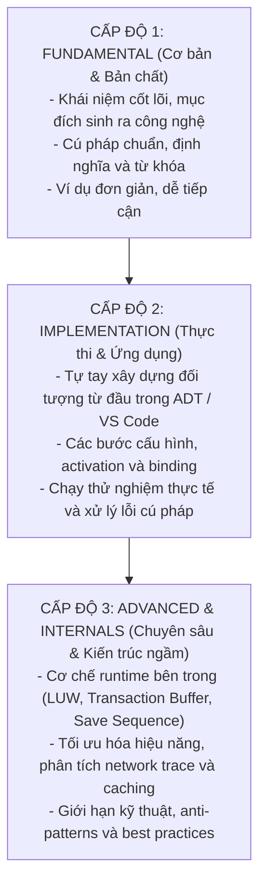
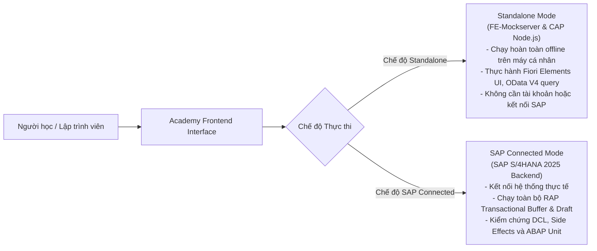

# TỔNG QUAN DỰ ÁN: SAP FIORI TECHNICAL ACADEMY – V4

---

## 1. Tầm nhìn & Mục tiêu Cốt lõi

**SAP Fiori Technical Academy – V4** là nền tảng học tập, thực hành và trình diễn kỹ thuật chuyên sâu về các công nghệ giao diện và phát triển ứng dụng hiện đại nhất của SAP:
- **SAP Fiori Elements OData V4** (Metadata-driven development)
- **Freestyle SAPUI5** (MVC, Custom Controls, Responsive Layouts)
- **OData V4 Protocol** (Metadata, Batch, Query Options, Actions/Functions)
- **ABAP RESTful Application Programming Model (ABAP RAP)** trên nền **SAP S/4HANA 2025**

### Điểm khác biệt Cốt lõi:
Dự án **KHÔNG XÂY DỰNG** bất kỳ ứng dụng quản lý nghiệp vụ kiểu cũ nào (như Quản lý Đơn hàng Bán Sales Order, Đơn Mua Hàng Purchase Order, Quản lý Nhân sự, Quản lý Bảo trì Thiết bị PM, Quản lý Kho...).

Thay vào đó, dự án tập trung 100% vào **Kỹ thuật Lập trình và Kiến trúc Hệ thống SAP**. Mọi tính năng kỹ thuật được tổ chức thành các phòng thực hành chuyên biệt (**Technical Labs**), mỗi chủ đề là một bài nghiên cứu hoàn chỉnh từ bản chất runtime đến mã nguồn thực tế.

---

## 2. 5 Nguyên tắc Thiết kế Dự án Bất biến (Core Principles)

| STT | Nguyên Tắc | Nội Dung & Yêu Cầu Thực Thi |
| :---: | :--- | :--- |
| **1** | **Technical-first** | 100% nội dung tập trung vào kỹ thuật lập trình SAP, kiến trúc framework, không làm loãng bằng logic nghiệp vụ kế toán hay mua bán. |
| **2** | **Deep Learning** | Không dừng lại ở mức "hướng dẫn click chuột"; giải thích cặn kẽ bản chất luồng thực thi, vòng đời bộ đệm giao dịch (transactional buffer) và cơ chế phía sau framework. |
| **3** | **Real Implementation** | Mọi chủ đề đều có mã nguồn hoàn chỉnh (CDS, BDEF, Behavior Pool, XML View, JS Controller) và có thể kiểm chứng chạy thật. |
| **4** | **Version-aware** | Ghi nhận rõ ràng phiên bản tối thiểu hỗ trợ, phân biệt sự khác biệt giữa các release S/4HANA và phân loại trạng thái hỗ trợ chuẩn xác. |
| **5** | **Reusable** | Các thành phần demo và phòng lab hoạt động độc lập, có thể tái sử dụng làm mẫu chuẩn (template/boilerplate) cho các dự án thực tế. |

---

## 3. Ba Cấp độ Thấu hiểu Kỹ thuật (3 Learning Levels)

Mỗi bài học kỹ thuật trong Academy không được trình bày dàn trải mà phải phân định rõ 3 cấp độ:

- **Fundamental:** Dành cho người mới tiếp cận chủ đề; nắm được "Cái này là gì?", "Khi nào nên dùng và khi nào không nên dùng?".
- **Implementation:** Dành cho lập trình viên thực chiến; biết chính xác từng bước tạo object trong Eclipse ADT / SAP GUI, cách liên kết CDS với UI5.
- **Advanced & Internals:** Dành cho Senior Architect; hiểu được framework hoạt động ra sao ở tầng bộ nhớ, thứ tự pha Save của RAP, cơ chế Side Effects batching của OData V4.

---

## 4. Miền Dữ liệu Kỹ thuật Độc lập (Generic Technical Domain)

Vì không sử dụng dữ liệu nghiệp vụ thương mại, dự án định nghĩa một miền dữ liệu kỹ thuật thuần túy để phục vụ minh họa toàn diện các cơ chế CRUD, Draft, Actions, Determinations, Validations và Side Effects:

1. **`DemoHeader` (`ZI_DemoHeaderTP`):** Đại diện cho thực thể cha cấp Root, chứa các thông tin trạng thái kỹ thuật (`StatusCode`), giá trị tổng (`TotalAmount`), loại tiền tệ (`CurrencyCode`), phục vụ kịch bản **Managed RAP with Draft**.
2. **`DemoItem` (`ZI_DemoItemTP`):** Đại diện cho thực thể con cấp Child, liên kết Composition với `DemoHeader`, chứa số lượng (`Quantity`), đơn giá (`UnitPrice`), phục vụ kịch bản tính toán tự động qua Determination và kích hoạt Side Effects làm tươi dữ liệu Header.
3. **`DemoConfig` (`ZI_DemoConfig*`):** Đại diện cho thực thể cấu hình hệ thống, phục vụ minh họa 2 kịch bản đặc thù:
   - *Scenario 2A:* **Managed with Unmanaged Save** (Tự viết logic lưu dữ liệu legacy trong saver method `save_modified`).
   - *Scenario 2B:* **Pure Unmanaged RAP** (Tự kiểm soát toàn bộ vòng đời CRUD trong Behavior Pool tuân thủ RAP contract).
4. **`DemoLog` (`ZI_DemoLog`):** Đại diện cho thực thể tra cứu lịch sử kỹ thuật ảo, minh họa kịch bản **CDS Custom Entity** kết hợp với Class triển khai interface **`IF_RAP_QUERY_PROVIDER`** để trả về dữ liệu on-the-fly mà không cần bảng database vật lý.

---

## 5. Mô hình Kiến trúc Thực thi Kép (Dual Execution Architecture)

Để giải quyết bài toán người học không phải lúc nào cũng có sẵn hệ thống SAP S/4HANA 2025 đang online, hệ thống được thiết kế hỗ trợ 2 chế độ vận hành:

- **Standalone Mode:** Đảm bảo tính sẵn sàng cao, học tập mọi lúc mọi nơi trên môi trường Node.js local.
- **SAP Connected Mode:** Cung cấp trải nghiệm doanh nghiệp chân thực, xác thực và kiểm chứng sâu các cơ chế transactional phức tạp của SAP ABAP Platform 2025.

