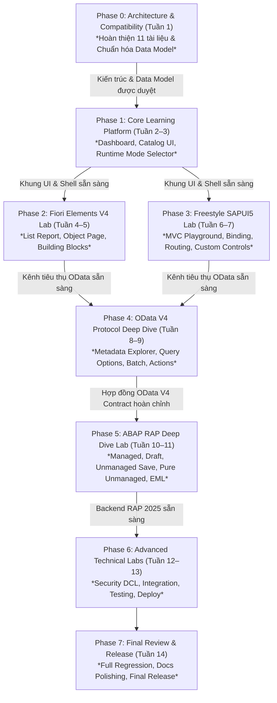

# LỘ TRÌNH PHÁT TRIỂN 14 TUẦN: DEVELOPMENT ROADMAP
*(SAP Fiori Technical Academy – V4)*

---

## 1. Sơ đồ Phụ thuộc Nghiêm ngặt giữa các Giai đoạn (Dependency Graph)

Lộ trình dự án được thiết kế chặt chẽ theo nguyên tắc **Contract-first & Technical-first**. Mỗi giai đoạn đều có các điều kiện tiên quyết (Prerequisites) bắt buộc phải hoàn thành và nghiệm thu trước khi bước sang giai đoạn tiếp theo:

> [!CAUTION]
> **Ràng buộc Phụ thuộc Sống còn:**
> Tuyệt đối không triển khai **Phase 5 (ABAP RAP Lab)** trước khi hoàn thành **Phase 0** và **Phase 4**, bởi vì cấu trúc Entity, CDS Annotations, và OData V4 Contract phải được đóng băng chuẩn xác trước khi tiến hành code và activate các Behavior Pool trong ABAP Platform 2025.

---

## 2. Chi tiết Kế hoạch 14 Tuần & Tiêu chí Nghiệm thu

---

### GIAI ĐOẠN 0: KIẾN TRÚC & TƯƠNG THÍCH PHIÊN BẢN (TUẦN 1)
- **Mục tiêu:** Đóng băng toàn bộ kiến trúc đa tầng, xác lập baseline tương thích SAP S/4HANA 2025, chuẩn hóa mô hình dữ liệu kỹ thuật và thiết lập checklist theo dõi.
- **Nhiệm vụ:**
  1. Thiết lập cấu trúc thư mục dự án phân tầng sạch sẽ.
  2. Xây dựng 11 tài liệu kiến trúc kỹ thuật trong thư mục `docs/`.
  3. Khởi tạo `docs/AI_TASK_PLAN.md` làm nguồn quản lý tiến độ duy nhất.
  4. Thực hiện kiểm tra tính nhất quán chéo (Cross-consistency Check).
- **Deliverables:** Trọn bộ 11 tài liệu kỹ thuật hoàn chỉnh và khung thư mục sạch.
- **Acceptance Criteria:** Toàn bộ tài liệu đạt chuẩn nghiệm thu Phase 0; không có bất kỳ dòng code ứng dụng nào được sinh ra.

---

### GIAI ĐOẠN 1: CORE LEARNING PLATFORM (TUẦN 2–3)
- **Mục tiêu:** Xây dựng ứng dụng Fiori Freestyle trung tâm đóng vai trò cổng điều hướng, trình diễn mã nguồn và quản lý chế độ chạy.
- **Nhiệm vụ:**
  1. Khởi tạo dự án UI5 với UI5 Tooling v4 (`package.json`, `ui5.yaml`, `manifest.json`).
  2. Xây dựng Home Dashboard & Điều hướng trung tâm với theme `sap_horizon`.
  3. Xây dựng Technical Catalog Explorer với bộ lọc đa tiêu chí (Category, Level, Execution Mode).
  4. Xây dựng Runtime Mode Selector hỗ trợ chuyển đổi Standalone (Mock) / SAP Connected kèm Hard Reload.
  5. Xây dựng Code Explorer với tính năng Syntax Highlighting và giải thích đoạn mã.
- **Deliverables:** Ứng dụng web Core Learning Platform chạy ổn định trên môi trường local.
- **Acceptance Criteria:** Điều hướng mượt mà, chuyển đổi Runtime Mode an toàn không phát sinh lỗi bộ nhớ.

---

### GIAI ĐOẠN 2: FIORI ELEMENTS V4 LAB (TUẦN 4–5)
- **Mục tiêu:** Xây dựng phòng thực hành Fiori Elements OData V4 hoàn chỉnh cho thực thể `DemoHeader`.
- **Nhiệm vụ:**
  1. Cấu hình middleware `@sap-ux/ui5-middleware-fe-mockserver` nạp metadata OData V4 và annotation.
  2. Xây dựng List Report Floorplan V4 với FilterBar và Table tùy biến.
  3. Xây dựng Object Page Floorplan V4 với Header Facets, Sub-sections và Responsive Table.
  4. Thực hành nhúng các Building Blocks V4 (`sap.fe.macros.Table`, `FilterBar`, `Field`).
  5. Cài đặt Controller Extensions và thêm Custom Actions.
  6. Triển khai và kiểm chứng cơ chế Side Effects trên Fiori Elements V4.
- **Deliverables:** Phòng thực hành Lab 01 hoạt động độc lập trên cả Mock và SAP thật.
- **Acceptance Criteria:** List Report và Object Page hiển thị chuẩn xác, Side Effects tự động làm tươi dữ liệu phụ thuộc.

---

### GIAI ĐOẠN 3: FREESTYLE SAPUI5 LAB (TUẦN 6–7)
- **Mục tiêu:** Xây dựng phòng thực hành Freestyle SAPUI5 chuyên sâu về các kỹ thuật UI5 nâng cao.
- **Nhiệm vụ:**
  1. Thiết lập SAPUI5 Playground với cấu trúc chuẩn MVC.
  2. Thực hành toàn diện Data Binding: Property, List/Aggregation, Element/Context, Expression Binding.
  3. Cấu hình Dynamic Routing với tham số URL và Nested Targets.
  4. Xây dựng hệ thống quản lý lỗi qua `sap.ui.core.message.MessageManager` và `MessagePopover`.
  5. Phát triển Custom Controls mở rộng từ `sap.ui.core.Control`.
  6. Tái sử dụng giao diện bằng XML Fragments và Dialogs.
- **Deliverables:** Phòng thực hành Lab 02 với đầy đủ ví dụ mã nguồn và demo trực quan.
- **Acceptance Criteria:** Chạy trơn tru toàn bộ các bài thực hành binding và routing mà không có lỗi console.

---

### GIAI ĐOẠN 4: ODATA V4 PROTOCOL DEEP DIVE (TUẦN 8–9)
- **Mục tiêu:** Mổ xẻ chi tiết giao thức OData V4 từ tầng mạng đến tầng mô hình dữ liệu.
- **Nhiệm vụ:**
  1. Xây dựng OData V4 Explorer: Metadata Inspector và Interactive Request Builder.
  2. Kiểm thử và phân tích toàn diện các Query Options: `$filter`, `$expand`, `$select`, `$orderby`, `$search`.
  3. Thực hành gọi Bound Actions, Unbound Actions và Functions.
  4. Thực hành đóng gói Multipart `$batch` Requests và Change Sets.
  5. Kiểm chứng cơ chế Optimistic Concurrency Control qua ETag và HTTP header `If-Match`.
- **Deliverables:** Phòng thực hành Lab 03 hỗ trợ phân tích sâu payload OData V4.
- **Acceptance Criteria:** Request Builder gửi và nhận phản hồi chuẩn OData V4 JSON format.

---

### GIAI ĐOẠN 5: ABAP RAP DEEP DIVE LAB (TUẦN 10–11)
- **Mục tiêu:** Lập trình mã nguồn ABAP RAP 2025 hoàn chỉnh trong Eclipse ADT, triển khai 3 kịch bản kiến trúc.
- **Nhiệm vụ:**
  1. Tạo CDS View Entities và Metadata Extensions cho `ZI_DemoHeaderTP` và `ZI_DemoItemTP`.
  2. Định nghĩa Behavior Definition (BDEF) với `strict(2);` và `with draft;`.
  3. Lập trình Behavior Pool: Determinations, Validations, Static & Instance Actions, Dynamic Feature Control.
  4. Triển khai Kịch bản 2A: Managed with Unmanaged Save (`ZI_DemoConfigManagedSaveTP`).
  5. Triển khai Kịch bản 2B: Pure Unmanaged RAP (`ZI_DemoConfigUnmanagedTP`).
  6. Triển khai Kịch bản 3: CDS Custom Entity với `IF_RAP_QUERY_PROVIDER` (`ZI_DemoLog`).
  7. Tạo Service Definition và Service Binding (OData V4 Web API & UI).
  8. Xây dựng EML Playground thực hành đọc/ghi Business Object bằng mã ABAP.
- **Deliverables:** Gói ABAP Package hoàn chỉnh trên hệ thống SAP S/4HANA 2025.
- **Acceptance Criteria:** Activate thành công toàn bộ đối tượng ABAP; Service Binding chạy thử nghiệm đạt kết quả chuẩn trên Fiori Elements Preview.

---

### GIAI ĐOẠN 6: ADVANCED TECHNICAL LABS (TUẦN 12–13)
- **Mục tiêu:** Triển khai các phòng thực hành bảo mật, tích hợp, kiểm thử và đóng gói triển khai.
- **Nhiệm vụ:**
  1. **Security Lab (Lab 07):** Viết DCL Access Control phân quyền theo user, phân quyền PFCG.
  2. **Integration Lab (Lab 06):** Cấu hình SM59, UI5 Proxy middleware, mô phỏng kết nối BTP.
  3. **Testing Lab (Lab 08):** Viết bộ test QUnit (Logic), OPA5 (Journey), và ABAP Unit Test cho RAP BO.
  4. **Deployment Lab (Lab 09):** Đóng gói qua `@sap/ux-ui5-tooling` deploy vào BSP/CTS, cấu hình FLP Spaces & Pages.
- **Deliverables:** Hoàn thành 4 phòng thực hành nâng cao (Lab 06, 07, 08, 09).
- **Acceptance Criteria:** Test suites tự động pass 100%; ứng dụng xuất hiện chuẩn xác trên Fiori Launchpad.

---

### GIAI ĐOẠN 7: FINAL REVIEW, COMPATIBILITY & RELEASE (TUẦN 14)
- **Mục tiêu:** Kiểm thử hồi quy toàn diện, đối soát thực tế hệ thống và đóng gói bàn giao sản phẩm.
- **Nhiệm vụ:**
  1. Thực hiện Regression Testing toàn bộ 9 Technical Labs trên cả 2 chế độ Standalone và Connected.
  2. Đối soát thực tế hệ thống S/4HANA 2025 và cập nhật `docs/VERSION_COMPATIBILITY.md` sang trạng thái `Supported`.
  3. Hoàn thiện tài liệu tra cứu và hướng dẫn sử dụng.
  4. Đóng gói mã nguồn và phát hành bản phát hành chính thức (Final Release).
- **Deliverables:** Sản phẩm SAP Fiori Technical Academy – V4 hoàn chỉnh, sẵn sàng sử dụng lâu dài.
- **Acceptance Criteria:** Tất cả các bài lab chạy trơn tru, không có lỗi tiềm ẩn, tài liệu đồng bộ 100%.

