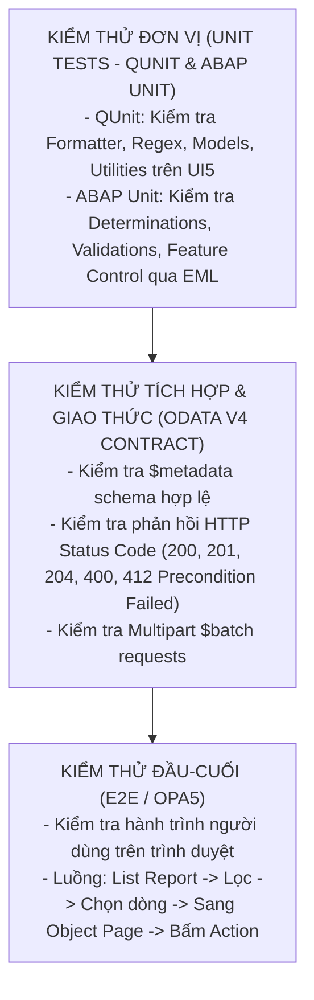

# CHIẾN LƯỢC KIỂM THỬ TỰ ĐỘNG: TEST STRATEGY
*(SAP Fiori Technical Academy – V4)*

---

## 1. Kim tự tháp Kiểm thử Đa tầng (Test Pyramid)

Dự án áp dụng mô hình kiểm thử toàn diện kết hợp giữa kiểm thử tầng giao diện (Client-side) và kiểm thử tầng lõi Business Object (Backend-side):



---

## 2. Kiểm thử Tầng Giao diện (Client-side Testing)

### 2.1. QUnit: Kiểm thử Đơn vị Logic UI5
- **Công cụ:** QUnit framework tích hợp sẵn trong SAPUI5 SDK.
- **Phạm vi:** Kiểm tra các hàm logic độc lập, formatters, regex validation, custom controllers logic.
- **Ví dụ Test Case Formatter:**
  ```javascript
  sap.ui.define([
    "academy/model/formatter"
  ], function (formatter) {
    "use strict";

    QUnit.module("Status Formatter Tests");

    QUnit.test("Kiểm tra trạng thái Đã phê duyệt (AP)", function (assert) {
      assert.strictEqual(formatter.statusState("AP"), "Success", "Mã AP phải trả về State Success (Xanh lá)");
    });

    QUnit.test("Kiểm tra trạng thái Bị từ chối (RJ)", function (assert) {
      assert.strictEqual(formatter.statusState("RJ"), "Error", "Mã RJ phải trả về State Error (Đỏ)");
    });
  });
  ```

### 2.2. OPA5: Kiểm thử Hành trình Người dùng (One Page Acceptance)
- **Công cụ:** OPA5 framework của SAPUI5.
- **Phạm vi:** Tự động hóa thao tác người dùng: Tìm kiếm trên FilterBar -> Nhấn nút Go -> Kiểm tra số lượng dòng hiển thị trên Table -> Điều hướng sang Object Page.
- **Quy tắc:** Sử dụng cơ chế chờ bất đồng bộ tự động của OPA5 (`waitFor`) để đảm bảo không bị lỗi race condition khi OData V4 đang nạp dữ liệu.

---

## 3. Kiểm thử Tầng Lõi Nghiệp vụ (Backend ABAP Unit for RAP)

### 3.1. Nguyên tắc ABAP Unit cho Business Object
- **Công cụ:** ABAP Unit Test Framework chạy trực tiếp trong Eclipse ADT (Phím tắt: `Ctrl + Shift + F10`).
- **Cơ chế:** Sử dụng cú pháp EML (`MODIFY ENTITIES`, `COMMIT ENTITIES`) để kiểm tra Determinations và Validations trong một phiên Transactional LUW cô lập mà không làm bẩn dữ liệu thật trong database.

### 3.2. Cấu trúc Mã Kiểm thử ABAP Unit Mẫu
```abap
CLASS ltcl_demo_header_test DEFINITION FINAL FOR TESTING
  DURATION SHORT
  RISK LEVEL HARMLESS.

  PRIVATE SECTION.
    CLASS-DATA:
      mo_environment TYPE REF TO if_cds_test_environment.

    CLASS-METHODS:
      class_setup,
      class_teardown.

    METHODS:
      test_calculate_total FOR TESTING.
ENDCLASS.

CLASS ltcl_demo_header_test IMPLEMENTATION.
  METHOD class_setup.
    " Giả lập môi trường test cô lập cho CDS
    mo_environment = cl_cds_test_environment=>create( 'ZI_DEMOHEADERTP' ).
  ENDMETHOD.

  METHOD class_teardown.
    mo_environment->destroy( ).
  ENDMETHOD.

  METHOD test_calculate_total.
    " 1. Tạo mới bản ghi Header qua EML
    MODIFY ENTITIES OF ZI_DemoHeaderTP
      ENTITY DemoHeader
      CREATE FIELDS ( DemoCode StatusCode )
      WITH VALUE #( ( %cid = 'ROOT1' DemoCode = 'TEST01' StatusCode = 'DR' ) )
      FAILED DATA(lt_failed)
      REPORTED DATA(lt_reported).

    cl_abap_unit_assert=>assert_initial( lt_failed-demoheader ).

    " 2. Kích hoạt Action tính toán
    MODIFY ENTITIES OF ZI_DemoHeaderTP
      ENTITY DemoHeader
      EXECUTE calculateTotals
      FROM VALUE #( ( %cid_ref = 'ROOT1' ) )
      RESULT DATA(lt_result).

    " 3. Xác thực kết quả
    cl_abap_unit_assert=>assert_not_initial( lt_result ).
  ENDMETHOD.
ENDCLASS.
```

---

## 4. Kế hoạch Tích hợp Kiểm thử Tự động (Automation Runner)

| Loại Test | Lệnh Chạy Cục Bộ (CLI) | Môi Trường Thực Thi | Tiêu Chí Đạt Nghiệm Thu |
| :--- | :--- | :--- | :--- |
| **Lint & Static Check** | `npm run lint` | Local Node.js | Không có lỗi cú pháp ESLint |
| **QUnit Suite** | `npm run test:unit` | Headless Chrome / Karma | 100% test assertions pass |
| **OPA5 Suite** | `npm run test:opa` | Headless Chrome / Karma | Toàn bộ UI journeys hoàn tất không timeout |
| **ABAP Unit Suite** | `Ctrl + Shift + F10` | Eclipse ADT (SAP S/4HANA) | 100% ABAP Unit tests pass, không dump ST22 |
| **OData Metadata Check**| Script kiểm tra XML | SAP Gateway Endpoint | Schema EDMX V4 hợp lệ, không có lỗi runtime |

